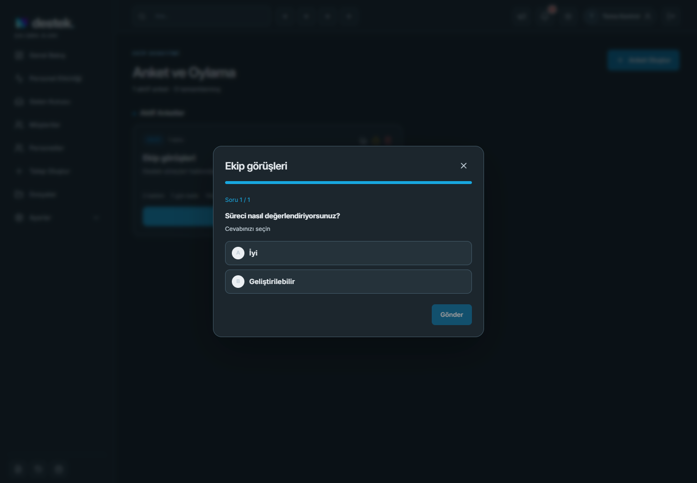

# Renk incelemesi — 4 Kasım 2026

**Güncel durum:** Sonraki kullanıcı isteği üzerine 1, 2, 3, 4, 6 ve 7 numaralı gruplardaki renk düzeltmeleri uygulandı. Dahili not için 5 numaradaki yeniden tasarım önerisi uygulanmadı; genel mesaj kurallarının neden olduğu renkli iç kutu kaldırılarak önceki saydam not gövdesi geri getirildi. [Düzeltme ve doğrulama kaydı](renk-duzeltmeleri-2026-11-04.md).

**Aşağıdaki metin ve görüntüler ilk inceleme anının kaydıdır; düzeltmelerden önceki durumu gösterir.**

Genel mavi palet ana yüzeylerde tutarlı. Ancak dolu içerikler ve alt ekranlar kontrol edildiğinde **7 ortak sorun grubu** bulundu. Ayrıca başarı durumlarının yeşil kalıp kalmaması için ayrı bir tasarım kararı gerekiyor.

İlk incelemede 1–3 numaralı bulgular öncelikli olarak işaretlendi. Sonraki uygulama durumu yukarıdaki düzeltme kaydında tutuluyor.

## Kontrol kapsamı

- Yerel uygulama: `http://127.0.0.1:5174`.
- Açık ve gece modu; 1440 × 1000 masaüstü ve 390 × 844 mobil.
- Yönetici, personel, müşteri ve oturumsuz kullanıcı görünümleri.
- **92 ekran durumu / 184 görünüm.** Aynı ortak bileşenin farklı yerlerdeki tekrarları ayrı hata sayılmadı.
- Boş ekranlarla sınırlı kalınmadı: örnek talepler, farklı durumlar, bildirimler, anket, dahili not, personel kayıtları ve rapor verileri kullanıldı.
- Görüntülerin tümü bu inceleme sırasında alındı. Raporda kullanılan örnekler dosyadan açılarak ayrıca incelendi.

Bu bir renk ve okunurluk incelemesidir. Küçük yazılarda 4,5:1, büyük yazılarda 3:1 kontrast hedefi kullanıldı. Devre dışı düğmeler, logo ve dekoratif semboller normal metin hatası olarak değerlendirilmedi. Dayanak: [W3C — Contrast Minimum](https://www.w3.org/WAI/WCAG22/Understanding/contrast-minimum.html).

## 1. Gece modunda bazı mavi yazılar koyu zeminde kayboluyor

**Öncelik: Yüksek.**

- Takvimde duyuru başlıkları.
- Bildirimler sayfasında “Okundu İşaretle” düğmeleri.
- Anket kartında “Aktif” etiketi.
- Anket oluştururken seçili “Bildirim / Uygulama içi bildirim” alanı.

Bu alanlarda yazı `#0879ad`, zemin `#1a3548`. Ölçülen kontrast yaklaşık **2,64:1**. Yakındaki diğer yazılar açık mavi olduğu için bu alanlar özellikle soluk görünüyor.

**Öneri:** Koyu tema için mevcut açık mavi gezinme/metin rengini kullanmak; açık tema için koyu maviyi korumak.

İlgili tanımlar: `frontend/src/readability.css:260`, `:269`, `:296`, `:300`, `:306`. Ortak neden, açık tema için uygun olan `--brand-primary-active` renginin koyu zeminde de metin rengi olarak kullanılması.

[Takvim kanıtı](color-review-2026-11-04/01-dark-calendar.png) · [Bildirimler kanıtı](color-review-2026-11-04/02-dark-notifications.png) · [Anket kartı kanıtı](color-review-2026-11-04/03-dark-surveys.png)

## 2. Anket cevaplarında A/B harfleri gece modunda çok silik

**Öncelik: Yüksek.**

Oy kullanma penceresinde A/B harfleri açık gri daire üzerinde açık gri kalıyor. Yaklaşık **1,36:1** kontrast ölçüldü. Seçenek metni okunuyor, fakat seçenek harfi neredeyse kayboluyor.

Anket oluşturucudaki seçenek harflerinde de açık renkli daire ve parlak mavi yazı birleşimi yaklaşık **2,33:1**.

**Öneri:** Koyu temada bu küçük rozetlerin zeminini koyulaştırıp harfleri açık mavi yapmak; açık temanın renklerini ayrı tutmak.

İlgili tanımlar: `frontend/src/pages/surveys.css:383`, `:532`.

## 3. Parlak mavi üzerinde beyaz küçük yazıların kontrastı düşük

**Öncelik: Yüksek.**

Açık moddaki “Kaydet”, “Rol Oluştur”, “Talepleri Görüntüleyin” gibi ana düğmelerde beyaz yazı ile `#18a7df` zemin yaklaşık **2,75:1** kontrast veriyor.

Gece modundaki standart ana düğmeler daha koyu mavi ve bu açıdan daha iyi. Ancak bağımsız stilleri olan “Oy Kullan” düğmesi ve rapordaki personel avatarı hâlâ parlak mavi/beyaz birleşimini kullanıyor. Sistem rehberindeki küçük numara rozetlerinde de aynı birleşim var.

**Öneri:** Beyaz yazı taşıyan küçük düğme ve rozetler için daha koyu bir mavi kullanmak; parlak maviyi vurgu, çizgi ve uygun ikonlarda sürdürmek. Bütün özel düğmeleri ortak tema renklerine bağlamak.

İlgili tanımlar: `frontend/src/readability.css:437`, `frontend/src/pages/surveys.css:106`, `frontend/src/features/management/reports.css:470`, `frontend/src/styles.css:6900`.

[Açık mod personel ekranı](color-review-2026-11-04/05-light-users.png) · [Gece modu anket kartı](color-review-2026-11-04/03-dark-surveys.png)

## 4. Açık modda bazı küçük bağlantılar fazla açık mavi

**Öncelik: Orta.**

Girişte “Şifremi Unuttum?” bağlantısı ve sistem rehberindeki bazı küçük başlıklar, açık zemin üzerinde `#18a7df` kullanıyor. Örneğin giriş bağlantısında yaklaşık **2,58:1** ölçüldü.

**Öneri:** Okunması gereken küçük bağlantı metinlerinde koyu mavi; parlak mavide ise çizgi, ikon veya daha büyük vurgu kullanmak.

İlgili tanımlar: `frontend/src/styles.css:910`, `:6055`, rehberdeki diğer doğrudan `#18a7df` metin tanımları.

[Giriş ekranı kanıtı](color-review-2026-11-04/06-light-login.png)

## 5. Dahili notun uyarı yazısı ve gece modu zemini tutarsız

**Öncelik: Orta.**

“Dahili not · Müşteriye görünmez” yazısı 10 px ve sarı/kahverengi tonda. Açık modda yaklaşık **3,40:1**, gece modunda **3,98:1** ölçüldü. Kullanıcıya önemli bir ayrımı anlattığından daha belirgin olmalı.

Gece modunda ayrıca kahverengi not zemininin içinde ayrı koyu bir mesaj dikdörtgeni oluşuyor. Açık moddaki bütünlüklü not görünümüyle eşleşmiyor.

**Öneri:** Not açıklamasına tema bazlı daha okunur renk vermek; gece modunda not kapsayıcısı ile mesaj gövdesini tek ve tutarlı bir yüzey olarak tasarlamak. Sarı uyarı vurgusunun kalması renk tercihi olarak ayrıca değerlendirilebilir.

İlgili tanımlar: `frontend/src/styles.css:3935`, `frontend/src/theme.css` içindeki genel `.message-content` kuralı ve dahili not yüzey kuralları.

[Açık mod notu](color-review-2026-11-04/07-light-internal-note.png) · [Gece modu notu](color-review-2026-11-04/08-dark-internal-note.png)

## 6. Açık moddaki bazı küçük etiketler sınırda kalıyor

**Öncelik: Orta; 1–3 kadar belirgin değil.**

- Form alanı etiketleri: yaklaşık **4,37:1**; örneğin Ad Soyad, E-Posta, Rol.
- Kanal etiketleri: yaklaşık **4,40:1**.
- Seçili sol menü, bildirim sayacı ve “Bildirimlere Git”: yaklaşık **4,07:1**.
- “Beklemede” durum etiketi: yaklaşık **4,23:1**; “Çözüldü” etiketi yaklaşık **4,43:1**.

Bu alanlar tamamen okunmaz durumda değil; küçük boyutta ve daha düşük kaliteli ekranlarda sorun yaratabilecek sınırda örnekler. Bildirim alt alanının istenen açık mavi zemini korunarak yalnız yazısı biraz koyulaştırılabilir.

**Öneri:** Küçük etiketlerdeki yazı tonlarını az miktarda koyulaştırmak; mevcut açık mavi zeminleri korumak.

İlgili tanımlar: `frontend/src/styles.css:309`, `:3417`, `:3425`, `frontend/src/theme.css` bildirim/kanal kuralları ve `frontend/src/readability.css` seçili menü kuralları.

[Bildirim paneli kanıtı](color-review-2026-11-04/09-light-notification-popover.png)

## 7. Rapor grafiğinde açıklama rengi ile sütun rengi eşleşmiyor

**Öncelik: Düşük; görsel tutarlılık.**

Gece modunda “Tamamlanan” açıklama noktası parlak mavi (`#18a7df`), ilgili sütun ise açık mavi (`#8ed5f5`). İkisi de mavi ailede, ancak aynı seriyi gösterdikleri için eşleşmeleri daha anlaşılır olur.

**Öneri:** Açıklama noktası ile sütunun aynı tema değişkenini kullanması.

İlgili tanımlar: `frontend/src/features/management/Reports.tsx` içindeki açıklama noktası ve `frontend/src/features/management/reports.css:357` içindeki `--report-accent`.

Not: Otomatik tarama, sütunun üstüne yerleştirilen sayıları sütunun zemininde sanarak iki ek kontrast uyarısı üretti. Görüntüde sayılar koyu panel üzerinde okunur olduğundan bu uyarılar bulguya dahil edilmedi.

[Rapor ekranı kanıtı](color-review-2026-11-04/10-dark-reports.png)

## Kullanıcı kararı: Başarı durumlarının yeşili kalacak mı?

Ana panel, menü ve bildirim yüzeylerinde eski yeşil marka zemini görülmedi. Ancak aşağıdaki yeşiller durum anlamı taşıyarak hâlâ mevcut:

- “Çözüldü” durum rozeti.
- Raporlardaki başarılı tamamlama yüzdeleri.
- Bazı başarı/işlem sonucu mesajlarının CSS tanımları.

Bu, tek başına hata olarak işaretlenmedi. Başarı durumları yeşil kalabilir veya bütün başarılı durumlar maviyle birleştirilebilir. Son tercih kullanıcı incelemesinden sonra yapılmalı. Kullanıcının yönettiği etiket/durum renkleri de sabit marka renklerinden ayrı ele alınmalı.

## Kontrol edilen alanlar

Yönetici tarafında: genel bakış; gelen kutusu ve beş farklı talep durumu; görüşme detayı, müşteri mesajı, personel yanıtı ve dahili not; işlem geçmişi; personeller; müşteriler; departmanlar; projeler; kategoriler; yetenekler; roller ve rol düzenleme; dosyalar; hazır yanıtlar; anket listesi, oluşturma ve cevaplama; takvim; bildirimler ve üst bildirim paneli; kayıt sayısı açılır menüsü; e-posta, SMS, WhatsApp, Form ve Cloudflare entegrasyon sekmeleri; yanıt süreleri; personel etkinliği; profil; sistem ve proje rehberi; raporlar; etkinlik kayıtları; telefon desteği.

Personel tarafında: gelen kutusu, görüşme detayı ve profil. Müşteri tarafında: genel bakış, talepler, yeni talep, talep detayı, profil ve bildirimler. Oturumsuz tarafta: giriş, destek formu ve talep takibi.

Kontrol edilen görünümlerde sayfa genelinde yatay taşma, büyük beyaz gece modu panelleri veya JavaScript ekran hatası görülmedi. Yatay kaydırılması amaçlanan tablolar bu değerlendirmede hata sayılmadı.

## Sınırlar ve kayıtlar

- API yanıtları yerel testte örnek verilerle karşılandı. Gerçek hesaplarda veri değiştirilmedi, mesaj gönderilmedi ve entegrasyonlar çalıştırılmadı.
- Bu sonuçlar canlı veri akışlarının, yetkilendirmenin veya tüm işlevlerin hatasız olduğunu göstermez.
- Gerçek dosya/Word/PDF önizlemeleri, harici içerikler, gerçek CAPTCHA ve bütün hata/başarı mesajlarının tüm varyasyonları ayrıca incelenmeli.
- Tüm klavye odağı ve üzerine gelme varyasyonları için tam erişilebilirlik sertifikasyonu yapılmadı. Renk incelemesindeki sonuçlar bunun yerine geçmez.
- Ham görüntüler ve tekrar çalıştırılabilen inceleme betiği: `.local/color-review-2026-11-04/`. Bu klasör git tarafından yok sayılır. Seçilmiş kanıt görüntüleri ve kapsam özeti bu raporun yanındaki `color-review-2026-11-04/` klasöründe ayrıca saklandı.
- Tasarım tercihi onaylandıktan sonra önerilen uygulama sırası: **1 → 2 → 3 → 4 → 5 → 6 → 7**.

## Kullanıcı inceleme listesi

- [ ] Gece modundaki koyu mavi yazılar için açık mavi tonunu değerlendir.
- [ ] Anket cevap ve oluşturma ekranlarındaki seçenek rozetlerini değerlendir.
- [ ] Beyaz yazılı ana düğmelerde daha koyu mavi kullanımını değerlendir.
- [ ] Açık mod bağlantı ve küçük etiket tonlarını değerlendir.
- [ ] Dahili notun sarı vurgusunu ve gece modu zeminini değerlendir.
- [ ] Rapor grafiği ile açıklama renklerinin eşleşmesini değerlendir.
- [ ] Başarı/çözüldü yeşilinin kalıp kalmayacağına karar ver.

**İlk incelemenin sonraki adımı kullanıcı kontrolüydü. Uygulanan değişiklikler ayrı düzeltme kaydında listelendi.**
